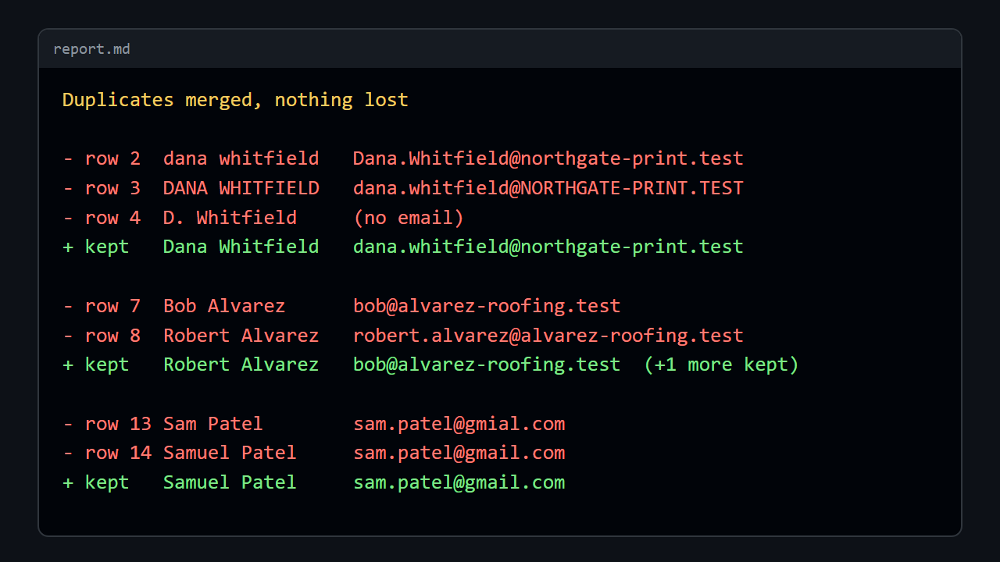
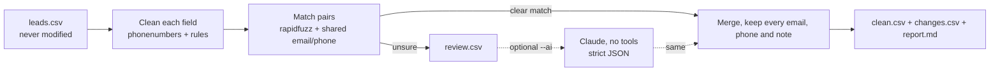

# lead-scrub

**lead-scrub** takes a messy lead or CRM export (CSV) and gives back a clean one: names fixed, emails and phone numbers checked and standardized, duplicate people merged, and a plain-English report of every change. It runs on your machine, needs no account, and never edits your original file.

1. **Fields are cleaned in code.** `dana whitfield` and `DANA WHITFIELD` become `Dana Whitfield`. `Okafor, Chidi` becomes `Chidi Okafor`. `(212) 555-0111` and `212.555.0111 x204` become `+12125550111` and `+12125550111 x204`. `sam@gmial.com` becomes `sam@gmail.com`. Company names are tidied (`okafor hvac llc` becomes `Okafor HVAC LLC`).
2. **Duplicates are found by evidence, not hunches.** Two rows are merged when they share an email or phone and the names fit, or when the name is nearly identical at the same company. `Bob` and `Robert`, `D. Whitfield` and `Dana Whitfield`, `García` and `Garcia` all match. Two people who share a front-desk mailbox, or two different `Alex Kim`s at different firms, are kept apart. Anything uncertain goes to `review.csv` for a person. Nothing is merged on a guess.
3. **Optional judgement from Claude.** With `--ai`, the borderline pairs are put to your locally signed-in [Claude Code](https://claude.com/claude-code) ("same person, different people, or unsure"). Its answer must be strict JSON for pairs it was actually shown. If Claude is missing, slow, or answers badly, lead-scrub carries on and leaves those pairs in `review.csv`.

<p align="center"><a href="docs/media/demo.mp4"></a></p>

A 30-second video of the run is at [`docs/media/demo.mp4`](docs/media/demo.mp4).

## What it caught

`demo/leads.csv` is 25 rows of made-up contacts (every email ends in `.test`, every phone is a `555-01xx` number). The real output is in [`demo/output/`](demo/output).

| In the file | What lead-scrub did |
| --- | --- |
| Three rows for Dana Whitfield (`dana whitfield`, `DANA WHITFIELD`, `D. Whitfield`) | One row, one email, one phone, the quote request and the call-back note both kept |
| `Bob Alvarez` and `Robert Alvarez`, different emails, same phone | One person, both emails kept |
| `sam@gmial.com` and `sam@gmail.com` | Domain typo fixed, then the two rows matched and merged |
| `Okafor, Chidi` and `Chidi Okafor` | Merged, name put in normal order |
| `info@brightpath-dental.test` on two different people | **Not** merged: a shared inbox is not a person |
| Two `Alex Kim`s at a bakery and a gym | **Not** merged: same name, different companies |
| `Tom Reyes` and `Maria Reyes` sharing one family email | **Not** merged, **flagged** for a person to decide |
| `not a phone`, `hannah.brooks@brooks-law` | Set aside and listed in the fix list, not silently kept |

25 rows in, 17 out, 35 field fixes, 1 pair left for a human. The report:

```
lead-scrub 0.1.0  leads.csv
----------------------------------------
rows in            25
rows out           17   (8 duplicates merged)
field fixes        35
invalid set aside  2
needs a human      1
----------------------------------------
wrote demo\output\clean.csv
wrote demo\output\changes.csv
wrote demo\output\review.csv
wrote demo\output\report.md
```

## How it works



Phone numbers are parsed and validated by Google's libphonenumber data (through the `phonenumbers` package), with `--region` setting the default country (US unless you say otherwise). Name similarity uses `rapidfuzz`, plus a small nickname table (Bob/Robert, Liz/Elizabeth, and so on), first-name initials, and accent-insensitive matching.

Merging never throws data away: every email, every phone, and the first non-empty value of every other column survive. `clean.csv` has a `source_rows` column so you can trace each row back to your original file, and `changes.csv` lists each before/after value with the reason.

## Try it

You need Python 3.10 or newer.

```bash
git clone <this repo> && cd lead-scrub
python -m venv .venv && . .venv/bin/activate        # Windows: .venv\Scripts\activate
pip install -e .                                    # installs rapidfuzz and phonenumbers
lead-scrub demo/leads.csv --out out                 # or: python -m lead_scrub demo/leads.csv
```

| Option | |
| --- | --- |
| `--out <folder>` | Where to write `clean.csv`, `changes.csv`, `review.csv`, `report.md` (default `./lead-scrub-out`). Files with those names in the folder are overwritten. The input file is never written to. |
| `--region US` | Default country for phone numbers without a `+` prefix (ISO code, such as `GB`, `CA`, `AU`). |
| `--ai` | Let the local Claude CLI judge borderline pairs. Needs `claude` signed in. Free of API keys; it uses your own plan. |

Columns are recognized by name: `name` or `first name` + `last name`, `email`, `phone` or `mobile`, `company`, with common variants. Any other columns (source, notes, owner, and so on) are kept. Input can be UTF-8 or Windows-1252, comma, semicolon, tab or pipe separated. Output opens cleanly in Excel.

## What it will not do

- It does not touch your CRM. It reads one CSV and writes four files.
- It does not verify that an email address exists or that a phone rings. "Valid" means well-formed and a real number plan.
- Very large groups (a single surname-and-initial, company, or email domain with more than 150 rows) are not compared by name, because there is too little signal. Matches on identical email or phone are always found.
- Names are cleaned for Western naming conventions. Mixed-case names are mostly left as you typed them.

## ROI

**About 3 hours a week saved, worth about $90 a week at $30 an hour** (roughly $4,700 a year).

How that is worked out, so you can change the numbers:

- A small business pulls in about **1,000 new or updated contacts a week**: web forms, trade-show scans, a CRM export, a purchased list.
- Cleaning those by hand in a spreadsheet (fix capitalization, retype phone numbers, sort by name and eyeball for duplicates, check the odd email, merge rows and carry over notes) takes about **11 seconds a row, or about 3 hours per 1,000 rows**. That is a rough figure, not a measured benchmark. Measure your own on 100 rows.
- lead-scrub does the same pass in about a second per 1,000 rows. You still read the `review.csv` and fix list, which is a few minutes.
- Value of time: **$30 an hour**, a loaded rate for an office assistant or marketing coordinator.
- Not counted: duplicate mailings and double sales calls you no longer make, bounced emails you no longer send, and the leads that used to fall through because two rows each held half the story.

`report.md` prints the same hours estimate for every file you run, using 3 hours per 1,000 rows.

## Security

CSV files come from forms and scans that strangers can type into, so lead-scrub treats every cell as hostile:

- **No formula injection.** Every cell written to a CSV that starts with `=`, `+`, `-`, `@`, a tab or a carriage return is prefixed with `'` so Excel and Sheets show it as text. Real phone numbers (`+12125550111`) are left alone.
- **The report is inert.** Names and emails in `report.md` are escaped, so no HTML, links, images, mentions or table breakouts.
- **Claude gets no tools.** `--ai` runs `claude -p --tools ""` with `--strict-mcp-config`, an empty MCP list, no saved session and slash commands off, in an empty temporary folder. The prompt goes in on stdin, never on the command line. Each batch of pairs is fenced with a random tag and labelled as data. The reply is accepted only as JSON for the pair numbers it was shown, with the answers `same`, `different` or `unsure`. The worst a hostile cell can do is push one borderline pair the wrong way. Exact email and phone matches never go to Claude.
- **No network, no credentials.** lead-scrub itself makes no network calls. It never reads Claude's login files; it only starts the `claude` program you already use.
- **The input is never modified**, and lead-scrub refuses to write over it.
- **Pinned parts.** `rapidfuzz==3.14.3` and `phonenumbers==9.0.41` are pinned in `pyproject.toml`. Both were downloaded as wheels (no install scripts) into a quarantine folder and checked against [OSV](https://osv.dev) before use; neither had a known advisory.

## Credits and licences

| Project | What it does here | Version | License |
| --- | --- | --- | --- |
| [rapidfuzz](https://github.com/rapidfuzz/RapidFuzz) | Fuzzy name and company matching, typo distance for mail domains | 3.14.3 | MIT |
| [python-phonenumbers](https://github.com/daviddrysdale/python-phonenumbers) (port of Google's libphonenumber) | Parses, validates and formats phone numbers | 9.0.41 | Apache-2.0 |
| [Claude Code](https://claude.com/claude-code) | Optional, `--ai` only: judges borderline pairs, headless and with no tools | your install | Anthropic's terms |
| [pytest](https://pytest.org) | Test runner (development only) | 8.3.4 | MIT |

lead-scrub's own code is [MIT](LICENSE). The README frames and video are made by [`docs/make_media.py`](docs/make_media.py) from a real run, using headless Chrome (or Edge) and ffmpeg: `python docs/make_media.py`.

## Tests

```bash
pip install -e ".[dev]"
python -m pytest
```

33 tests cover name, email, phone and company cleanup, the matching rules on the demo file (what merges and what must not), a nameless row that must not join two people, odd inputs (empty, ragged, semicolon, Windows-1252), formula-injection and Markdown escaping, the command-line guard rails, and the Claude step (strict parsing, graceful fallback, prompt only on stdin).

---

Built for a *Today in AI* episode as a working example. It is a demo, not a maintained product, so issues and pull requests may not get answers.
